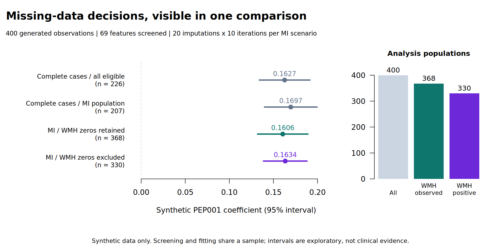

# Missing-data sensitivity analysis

**See how missing-data and measurement-handling choices change a regression estimate.**

An R workflow for missingness exploration, feature screening, complete-case regression, and pooled multiple imputation with `mice`. Individual PSYC 8803 coursework, Fall 2025, presented as a reproducible **synthetic-data demo**.

[View results](#results-at-a-glance) · [Run the analysis](#run-the-analysis) · [Validation](docs/VALIDATION.md)

## Results at a glance



All 400 rows are generated from equations. **No real ADNI data or clinical findings are included.** The workflow screens 69 artificial peptide-like features and selects `PEP001`, which appears in the generator's response equation.

| Analysis | Rows used | PEP001 estimate | 95% interval |
|---|---:|---:|---|
| Complete cases, all eligible | 226 | 0.1627 | [0.1341, 0.1914] |
| Complete cases within the MI population | 207 | 0.1697 | [0.1399, 0.1995] |
| Multiple imputation, WMH zeros retained | 368 | 0.1606 | [0.1320, 0.1892] |
| Multiple imputation, WMH zeros excluded | 330 | 0.1634 | [0.1387, 0.1881] |

**What to notice:** excluding zero WMH values changes the analysis population from 368 to 330 rows. Estimates are similar in this generated sample; that is not proof of robustness for other data or missingness mechanisms. Intervals are exploratory because feature selection and estimation use the same sample.

[Exact estimates and intervals](docs/demo/coefficient-comparison.csv) · [Population counts](docs/demo/analysis-populations.csv) · [Figure generator](scripts/plot_results.R)

## Workflow

**Generate → inspect missingness → screen features → fit complete cases → impute and pool → compare measurement-handling scenarios.**

- Distinguish missing measurements from valid zero values.
- Summarize missingness and model associations with outcome availability.
- Screen 69 features with BH-adjusted screening p-values.
- Compare complete-case models with pooled `mice` regression estimates.
- Export an HTML report, diagnostic traces, a result figure, and machine-readable comparisons.

**Verified:** two Python tests and the full R/HTML pipeline passed. Both MI scenarios completed **20 imputations × 10 iterations**, with no `mice` logged events. The new figure reads estimates and intervals directly from fitted objects. [Execution details](docs/VALIDATION.md).

## Run the analysis

Requirements: Python 3 (standard library), R, and Pandoc. From the repository root:

```bash
python3 scripts/generate_demo.py
Rscript scripts/install_dependencies.R
Rscript scripts/render.R
```

Open `output/study.html`. To regenerate the portfolio figure and run the full analysis checks:

```bash
python3 -m unittest discover -s tests -v
Rscript scripts/plot_results.R
```

The figure and two comparison CSVs are written to `output/portfolio/`. This command also renders the report and runs `tests/validate_analysis.R`. Generated data and local output directories are ignored by Git.

### Docker alternative

```bash
python3 scripts/generate_demo.py
docker build -t missing-data-r .
docker run --rm -v "$PWD:/work" -w /work missing-data-r Rscript scripts/plot_results.R
```

Verified on Ubuntu 24.04 ARM64 with R 4.3.3 and mice 3.16.0. [Tested package versions](docs/tested-package-versions.tsv) describe the environment; Ubuntu packages may receive updates. Optional Bayesian regression is disabled by default and requires a separate brms/Stan installation.

## My analysis

My original coursework examined how missing-data decisions affect an estimated peptide–tau association, adjusting for age, sex, and measurement interval. It included missing-code restoration, missingness analysis, feature screening, complete-case regression, multiple imputation, and a comparison of zero-WMH handling.

This public edition retains that analytical structure with independently generated observations named `PEP001`–`PEP069`. Later additions include explicit feature selection, adjusted screening p-values, type-appropriate imputation, a matched-population complete-case comparison, diagnostics, and the result figure. [Source and changes](docs/PROVENANCE.md).

## Interpretation

Missingness patterns do not establish MCAR or MAR or exclude MNAR. BH adjustment during screening does not correct post-selection inference for the later regression. Restricting to observed WMH and excluding zeros changes who enters the model; this is a measurement-handling sensitivity analysis, not a general MNAR analysis. Inspect imputation diagnostics rather than assuming that a completed run proves convergence.

## Files and data boundaries

| Path | Purpose |
|---|---|
| `analysis/study.Rmd` | Synthetic-input analysis notebook |
| `scripts/` | Data generation, dependency installation, rendering, and result plotting |
| `tests/` | Generator checks and full-analysis invariants |
| `docs/demo/` | Aggregate synthetic estimates and population counts |

No participant records, original clinical results, original reports, course prompts, or original Git history are included. [Data handling](docs/DATA_HANDLING.md). No new software license is assigned; see [NOTICE](NOTICE.md).
